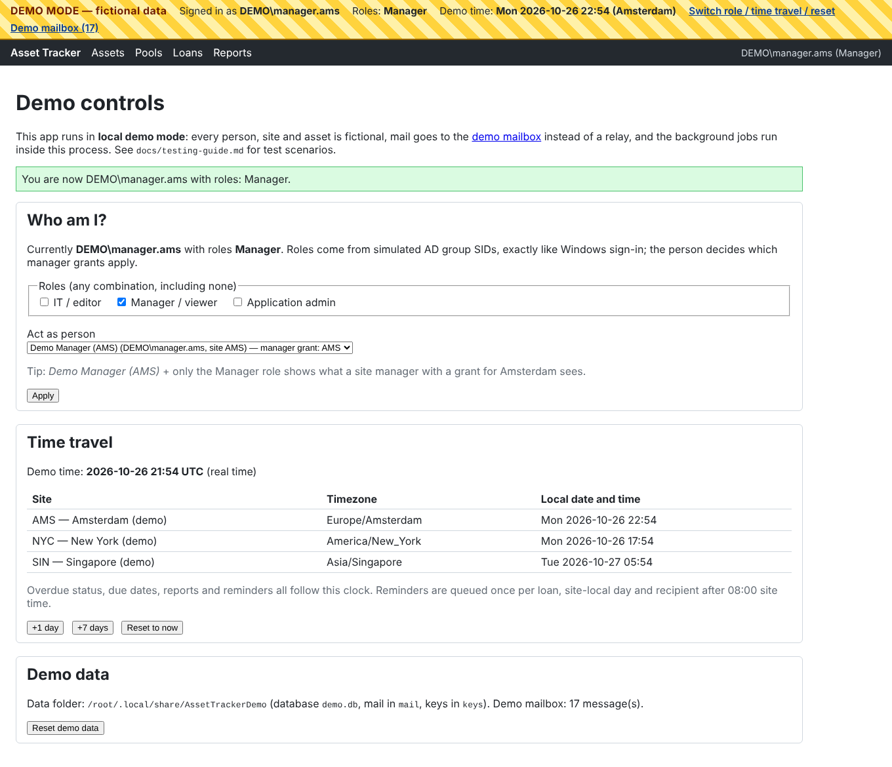
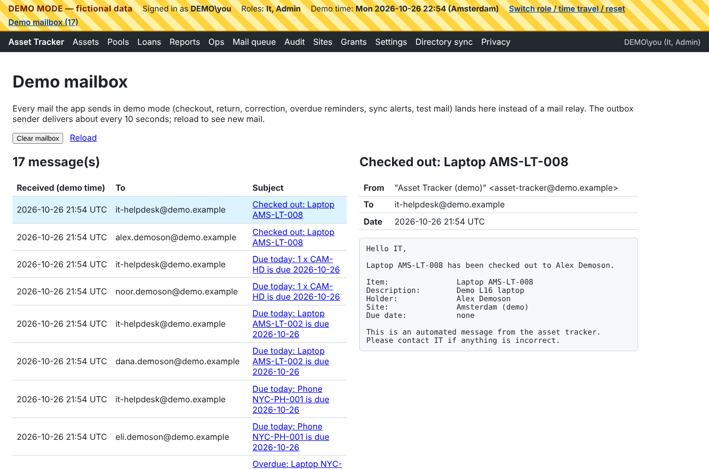
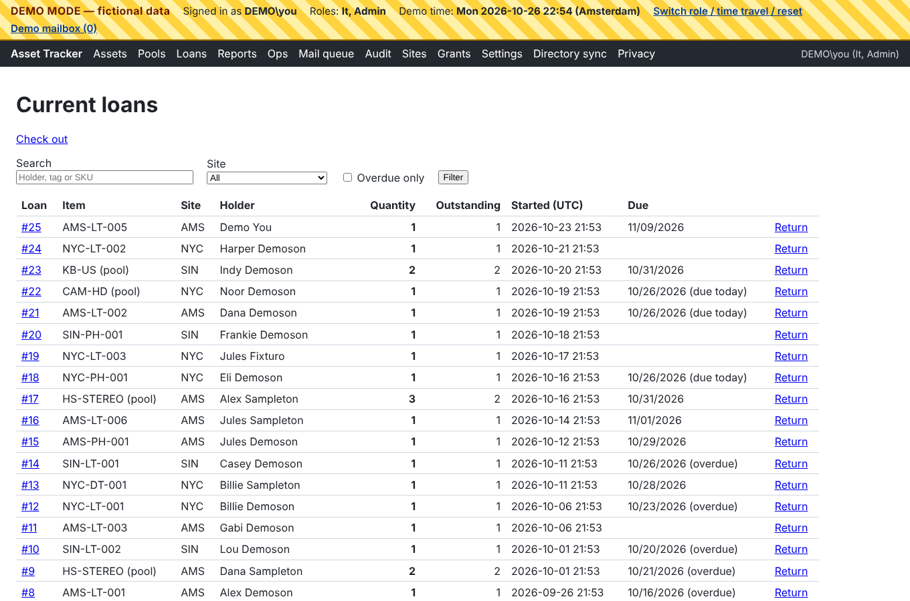

# Testing guide: local demo mode

This guide lets you try the whole asset tracker on your own computer: lending, returns, corrections, mail, reminders, reports, roles, settings and operations. You need no Active Directory, mail relay, SQL Server, IIS or Windows sign-in. Everything runs in one local process with **fictional data only**.

> The demo is for evaluation. It behaves like production in everything that matters for the scenarios below (same pages, services, permissions, audit and mail outbox). Only the parts around the app are simulated: sign-in, the database engine, the directory, the mail relay, the clock and the background worker. Those parts are tested on a real server separately (see [Testing on a real Windows server](#testing-on-a-real-windows-server)).

## 1. Prerequisites

- **The .NET 10 SDK.** This is the only thing you install. Get it from <https://dotnet.microsoft.com/download/dotnet/10.0> (choose *SDK*, version 10.0.100 or later). It works on Windows, macOS and Linux and needs no administrator rights after installation.
- A copy of this repository, either from `git clone` or as a ZIP download from GitHub.
- A web browser.

To check the SDK, open a terminal (on Windows, *PowerShell*) and run `dotnet --version`. It should print `10.0.x`.

## 2. Start the demo

Open a terminal in the repository folder (the one that contains `README.md`) and run:

```bash
dotnet run --project src/AssetTracker.Web --launch-profile Demo
```

- The first start compiles the app (about a minute) and then creates and fills the demo database (a few seconds).
- The browser opens <http://localhost:5080> automatically. If it doesn't, open that address yourself. The demo uses plain HTTP, so no certificate is needed.
- A striped **DEMO MODE — fictional data** banner appears at the top of every page.
- To stop the demo, press `Ctrl+C` in the terminal. To start it again, run the same command. Your data is kept between runs.
- If port 5080 is already in use, add a different address: `dotnet run --project src/AssetTracker.Web --launch-profile Demo -- --urls http://localhost:5090`.

**If the build fails with `error NU1100: Unable to resolve '…'`** for every package, NuGet on that machine has no usable package source. This is common on a fresh .NET install. The repository's `nuget.config` points at nuget.org, so first run `git pull` to make sure you have it. If it still fails, check `dotnet nuget list source`:
- If nuget.org isn't listed, run `dotnet nuget add source https://api.nuget.org/v3/index.json -n nuget.org`.
- If it's listed as disabled, run `dotnet nuget enable source nuget.org`.

Behind a company proxy, nuget.org must be reachable from the machine.

The `Demo` launch profile sets `ASPNETCORE_ENVIRONMENT=Development` and `Demo__Enabled=true`. Demo mode is honoured **only** in the Development environment. If `Demo:Enabled` is set anywhere else, the app refuses to start, so a demo setting can never take effect on a server.

## 3. Where the data lives, and how to reset it

| OS | Folder |
| --- | --- |
| Windows | `%LOCALAPPDATA%\AssetTrackerDemo` (for example `C:\Users\<you>\AppData\Local\AssetTrackerDemo`) |
| macOS | `~/Library/Application Support/AssetTrackerDemo` |
| Linux | `~/.local/share/AssetTrackerDemo` |

The exact folder is shown on the **Demo controls** page (`/Demo`). It contains `demo.db` (the SQLite database), `mail/` (the demo mailbox, one `.eml` file per message, which any mail program can open) and `keys/` (the encryption keys for the SMTP password field on the settings page). To use another folder, start with `Demo__DataDirectory=<path>` set in the environment.

**To reset**, use **Reset demo data** on `/Demo`. It deletes all data and mail, sets the clock back to now and seeds the fictional data again. You can also stop the app and delete the folder; the next start recreates everything. A demo database created by an older version of the app does not have the asset catalog tables (the demo schema is not migrated): delete the folder once after updating.

## 4. What is simulated

| Production | Demo mode |
| --- | --- |
| Windows Authentication (Kerberos), roles from AD group SIDs | A demo sign-in that issues the same claims (name, user SID, group SIDs) for the identity you choose on `/Demo`. The real role mapping, policies and site scoping run unchanged. |
| SQL Server | SQLite file `demo.db` (same data model) |
| Active Directory (paged LDAP query) | A fixed fictional directory of 151 entries (see §6) |
| SMTP relay to Microsoft 365 | The **demo mailbox** (`/Demo/Mailbox`). Mail is written as `.eml` files and shown as plain text. |
| Worker Windows service (outbox sender, reminders, sync, heartbeat) | The same jobs run inside the web process. The outbox is polled every 10 s, reminders every minute, the directory syncs hourly and the heartbeat runs every 30 s. |
| System clock | Real time plus a **time travel** offset (`/Demo`: +1 day, +7 days, reset) |
| Data Protection key ring (DPAPI) | A plain key folder `keys/` |

Demo defaults: default timezone `Europe/Amsterdam`, reminder time 08:00 site time, IT mailbox `it-helpdesk@demo.example`. You can change settings on **Admin → Settings** as in production. The directory and relay values shown there are placeholders, and a note on the page says that demo mode overrides them.

## 5. The demo controls



Open **Switch role / time travel / reset** in the banner (`/Demo`):

- **Roles:** tick any combination of *IT / editor*, *Manager / viewer* and *Application admin*, or none. These simulate membership of the three AD groups.
- **Act as person:** the person you are signed in as. This matters for managers, because manager grants are linked to a person. **Demo Manager (AMS)** (`DEMO\manager.ams`) has a grant for Amsterdam only. **Demo You** (`DEMO\you`, the default) has no grant.
- The default identity is `DEMO\you` with roles **IT + Admin**.
- **Time travel** moves the demo clock forward. Due dates, the overdue rule, reports and reminders all follow it. After a jump, a directory sync and a reminder pass run straight away.
- **Reset demo data** starts over.

Your choice is kept in a cookie, so each browser (or private window) can act as a different user at the same time.



The **demo mailbox** (`/Demo/Mailbox`) lists every message, newest first. Click a subject to read it. **Clear mailbox** deletes them all. Mail for the seeded history is marked as already sent, so after a reset the mailbox starts empty and fills with today's overdue reminders (for sites where it is already past 08:00 local time).



## 6. The fictional data

All names are made up, for example `Alex Demoson` or `Jules Sampleton`. All addresses end in `@demo.example` and all phone numbers come from ranges reserved for fiction.

**Sites**

| Key | Name | Timezone | Directory value |
| --- | --- | --- | --- |
| AMS | Amsterdam (demo) | Europe/Amsterdam | `Amsterdam` |
| NYC | New York (demo) | America/New_York | `New York` |
| SIN | Singapore (demo) | Asia/Singapore | `Singapore` |

**People** (directory of 151 entries; 149 people are synced and 146 are active)

- `you` (Demo You) and `manager.ams` (Demo Manager (AMS), granted site AMS). These are the role switcher's people.
- 144 regular people spread over the three sites. Usernames follow the pattern `first.surname`, for example `alex.demoson`.
- Disabled in the directory: `kai.demoson`, `frankie.sampleton` and the leaver `alex.testwell`. The leaver was active when the history was seeded and still holds an overdue laptop.
- Site value matches no site: `jules.fixturo` (`Utopia Office`) and `kai.fixturo` (`Remote`). They are synced without a site and reported as `unmapped-site`.
- No email address: `lou.fixturo`. This person is active but cannot receive new loans.
- Two entries share one directory id (`max.fixturo` and `noor.fixturo`). Both are quarantined as `duplicate-id` and never become people.

**Inventory:** 42 tagged assets: laptops (`…-LT-…`), desktops (`-DT-`), phones (`-PH-`, with valid IMEIs and phone numbers) and phone-number assets (`-PN-`). Two are retired (`AMS-LT-010`, `SIN-DT-003`). `NYC-LT-008` is unavailable (returned damaged). `AMS-LT-009` has a description that starts with `=` to demonstrate CSV formula neutralization. There are 12 pools, one per site for each of `HS-STEREO` (headsets), `CAM-HD` (webcams), `KB-US` (keyboards) and `MOUSE-W` (mice), with stock receipts, a loss and a transfer between sites in their history.

**Open loans** ("today" means each site's own local date)

| Item | Holder | Due |
| --- | --- | --- |
| AMS-LT-001 | Alex Demoson | 10 days overdue |
| AMS-DT-001 | Max Demoson | 2 days overdue |
| AMS-LT-004 | Alex Testwell (**inactive**) | 5 days overdue |
| HS-STEREO (AMS), 2 units | Dana Sampleton | 5 days overdue |
| AMS-LT-002 | Dana Demoson | due today |
| AMS-PH-001 | Jules Demoson | in 3 days |
| HS-STEREO (AMS), 3 units, **1 returned** | Alex Sampleton | in 5 days |
| AMS-LT-006 | Jules Sampleton (**corrected** from Gabi Sampleton) | in 6 days |
| AMS-LT-005 | Demo You | in 14 days |
| AMS-LT-003 | Gabi Demoson | no due date |
| NYC-LT-001 | Billie Demoson | 3 days overdue |
| NYC-PH-001 | Eli Demoson | due today |
| CAM-HD (NYC), 1 unit | Noor Demoson | due today |
| NYC-DT-001 | Billie Sampleton | in 2 days |
| NYC-LT-002 | Harper Demoson | no due date |
| NYC-LT-003 | Jules Fixturo (no site, D8) | no due date |
| SIN-LT-001 | Casey Demoson | 1 day overdue |
| SIN-LT-002 | Lou Demoson | 7 days overdue |
| KB-US (SIN), 2 units | Indy Demoson | in 4 days |
| SIN-PH-001 | Frankie Demoson | no due date |

**Closed history:** `AMS-LT-007` has two closed loans. `NYC-LT-007` was loaned to Billie Demoson at New York, returned, and then **moved to Amsterdam**. `NYC-LT-008` was returned damaged. A Singapore mouse loan was returned.

## 7. Scenario checklist

Each scenario names the acceptance gate of the MVP plan (`docs/mvp-plan.md` §6, "Stage n") or the sponsor decision (`docs/decisions.md`, D1–D11) that it demonstrates. Unless a scenario says otherwise, use the default identity (IT + Admin as `DEMO\you`). Switch identities on `/Demo`.

### IT / editor

- [ ] **Check out a laptop** (Stage 2). Go to *Loans → Check out*, enter tag `AMS-LT-008`, search a person (for example `alex`), pick a due date and confirm. **Expected:** the loan page opens and `AMS-LT-008` is *CheckedOut*. Within about 10 s the demo mailbox shows two *Checked out* messages: one to the holder and one to `it-helpdesk@demo.example`.
- [ ] **Person typeahead shows the site.** On *Loans → Check out* type `an` in *Person*. **Expected:** suggestions appear while typing, each with the person's name, username, email, job title and a site badge (`AMS`, `NYC`, `SIN` or *No site*). Arrow keys and Enter, or a click, pick one; *Find* then offers just that person, already selected, with a note when their site differs from the item's.
- [ ] **Missing email blocks checkout** (Stage 2). Try to check out to `lou.fixturo`. **Expected:** this person is not offered as a recipient, or the checkout is refused with "has no valid email address".
- [ ] **Inactive people cannot receive new loans** (Stage 1/2). Search `kai.demoson`. **Expected:** not offered for checkout.
- [ ] **Unmapped site can still borrow** (D8). `jules.fixturo` has no site and already holds `NYC-LT-003`. Check out another item to them. **Expected:** it works.
- [ ] **Pool checkout and partial return** (Stage 2). Open the open loan of 3 × `HS-STEREO` (Alex Sampleton, 1 returned) and choose *Return* with quantity 1. **Expected:** 1 unit is still outstanding, the loan stays open, the pool's available count goes up by 1 and a *Returned* mail is sent. Return the last unit and the loan closes.
- [ ] **No negative stock** (Stage 1). On a pool, try to check out more units than are available, or to record a loss larger than the available count. **Expected:** refused.
- [ ] **Correction with preview** (Stage 2, D1, D11). Open loan `AMS-LT-006` (Jules Sampleton) and choose *Correct*. Pick another holder and/or change the due date, then *Preview*. **Expected:** the preview lists the field changes and any conflicts, and nothing is saved yet. Enter a reason and *Commit*. **Expected:** a new *Corrected* event supersedes the latest one (the original stays visible). Mail goes to the old holder, the new holder and IT (deduplicated). Even a due-date-only correction sends mail (D1). The seeded correction is visible in the same loan's history.
- [ ] **Overlapping correction is rejected** (Stage 2). On `AMS-LT-007`'s first closed loan, try to move its return date past the start of the second loan. **Expected:** conflict, nothing saved.
- [ ] **Retire blocked while loaned** (Stage 2). Open `AMS-LT-001` and choose *Edit / change state*. **Expected:** no retire or move action, and the page says to return the asset first. The server also refuses a forged request (automated tests). Retire an available asset, for example `AMS-LT-008` after returning it. **Expected:** it is retired, its history is kept and the tag cannot be reused.
- [ ] **Site transfer blocked while loaned, allowed when available** (Stage 2). Same page: an available asset can be moved to another site, a checked-out one cannot.
- [ ] **Return to an inactive holder** (D10). Return `AMS-LT-004` (Alex Testwell, inactive). **Expected:** the return is not blocked. The holder's mail is recorded as *Skipped* (see *Mail queue*) and IT is still notified.
- [ ] **Reports and CSV** (Stage 3). *Reports → Inventory / Current loans / Overdue / History* each have filters, paging and *Export CSV*. Export the inventory and open it in a spreadsheet. **Expected:** the `AMS-LT-009` description starts with `'=HYPERLINK(` (neutralized; no formula runs). Each export is recorded in the audit log.
- [ ] **Audit log is IT only** (D2). *Audit* lists every change (checkout, return, correction, settings, exports, directory sync) with actor and time. There are no edit or delete actions.
- [ ] **Ops dashboard and mail queue** (Stage 3). *Ops* shows the app version, directory sync status, outbox counts and the worker heartbeat. *Mail queue* shows skipped and failed mail with reasons and a requeue action.
- [ ] **Directory sync history, read-only for IT** (D7). With IT only (untick Admin), *Directory sync* shows the history but no *Run sync now* button.

### Manager / viewer

Switch to **Demo Manager (AMS)** with only the **Manager** role.

- [ ] **Sees only granted sites** (Stage 1). *Assets*, *Pools*, *Loans* and *Reports* show AMS only. `NYC-LT-001` and `SIN-LT-001` are not listed, and opening their URLs directly returns *Not found*. CSV exports contain AMS only.
- [ ] **Sees prior holders after an asset moved** (plan §1, intentional disclosure). Open `NYC-LT-007` (now at AMS). **Expected:** its full history, including the New York holder *Billie Demoson*.
- [ ] **Read only** (Stage 1). There are no check out, return, correct or edit actions, and those URLs return *Forbidden*.
- [ ] **No audit** (D2). `/Audit` returns *Forbidden*.
- [ ] **Grants belong to a person and need the manager group** (D9). Act as `DEMO\you` with the Manager role. **Expected:** the inventory pages open but are empty (no grant). Act as Demo Manager (AMS) without any role (as if removed from the manager group). **Expected:** no inventory at all; the grant is kept and works again when the role comes back.

### Application admin

Switch to **Admin** only.

- [ ] **Admin alone sees no inventory** (Stage 1). There are no Assets, Loans or Reports links, and their URLs return *Forbidden*.
- [ ] **Tag generator and type-specific forms.** *Assets → New asset*, choose *Laptop* and a site. **Expected:** the form previews the next tag (for example `AMS-LT-011`); leaving the tag empty creates the asset with it. Choose *Phone*: vendor and model dropdowns and two IMEI fields. Choose *Phone number*: only the phone number, provider, SIM type, SIM status, SIM number and PUC (marked IT only).
- [ ] **Asset types, fields, vendors and models** (admin). *Asset types → Phone number*: switch standard fields, change the tag pattern (the example updates), add a custom field (for example a *Choice*), move it up or down and open a new asset form to see it. *Vendors* and *Models*: add a vendor and a model for *Laptop*, then pick it on a new laptop (choosing a vendor narrows the models). Deactivating a model removes it from new forms but not from existing assets. *Sites → Tag code* sets the `{SITE}` part of generated tags.
- [ ] **Sites and grants**. *Sites*: edit a site's timezone or directory value. *Grants*: grant `Demo Manager (AMS)` access to NYC, then switch to the manager and see NYC appear. Remove the grant again.
- [ ] **Settings: test directory query** (WP4.1). *Settings → Test directory query*. **Expected:** "Fetched 151 entries: 149 valid, 2 would be quarantined … 2 have an unmapped site value … 3 are disabled", plus a sample. Nothing is synced.
- [ ] **Settings: test email**. Enter an address (for example `you@demo.example`) and click *Send test email*. **Expected:** success, and the message is in the demo mailbox.
- [ ] **Settings: save and audit**. Change, for example, *Overdue reminder time* or *Include phone numbers in mail* (D5), then save. **Expected:** the change applies without a restart and is audited as `setting.update` (visible to IT). The SMTP password field is write-only.
- [ ] **Directory sync with issues** (Stage 1, D7). *Directory sync → Run sync now*. **Expected:** a *Succeeded* run with *fetched 151, quarantined 2*. The issue list shows `duplicate-id` (demo-duplicate-0001) and two `unmapped-site` values. The 3 disabled accounts are inactive.
- [ ] **Anonymize an inactive person** (privacy). *Privacy*: search `kai.demoson` or `frankie.sampleton` (inactive, no open loans), enter a reason, tick *I confirm* and click *Anonymize*. **Expected:** the person becomes `anonymized-<id>` and the action is audited. `alex.testwell` is refused until their open loan is returned.

### No role

- [ ] Untick all roles. **Expected:** the home page says you have no access, and every inventory, admin and audit URL returns *Forbidden* or *Not found*. `/Demo` stays reachable so you can switch back.

### Time, overdue and reminders (D4)

- [ ] **Due today counts as overdue (0 days).** *Loans* shows `AMS-LT-002` as "due today". The *Overdue* report includes it with 0 days overdue.
- [ ] **Per-site calendar.** `/Demo` shows each site's local date. Singapore is usually a day ahead of New York. Due dates and the overdue rule use the loan's own site.
- [ ] **Reminders after time travel.** Clear the mailbox, then click **+7 days**. **Expected:** within about 10 s the mailbox shows *Overdue* reminders. There is one per open overdue loan per recipient (holder + IT), only for sites whose local time is past 08:00. For example, `AMS-PH-001` (due in 3 days) is now overdue. The inactive leaver's loan (`AMS-LT-004`) gets an IT-only reminder that says the holder was not emailed. Undated loans get none.
- [ ] **Once per day per site.** Wait a few minutes (the reminder job runs every minute) and reload the mailbox. **Expected:** no duplicate reminders for the same day. Then click **+1 day**. **Expected:** exactly one new reminder per overdue loan and recipient for the new day.
- [ ] **Reset to now** returns the clock to real time. Mail queued "in the future" is still delivered.

### Operations

- [ ] `/health` returns 200 (liveness). `/health/ready` returns JSON with `database`, `directory-sync`, `mail-outbox` and `worker`, all *Healthy* (D3: a stale worker would be *Degraded*).
- [ ] Security headers: in the browser developer tools, every page has a strict Content-Security-Policy and the console shows no CSP violations.

### What the demo cannot show (covered by automated tests)

These run in `dotnet test` (all tests run against a real relational database):

- Two people checking out the same laptop, or overselling a pool, at the same instant (Stage 1/2 concurrency): `LendingServiceTests`, `PoolServiceTests`.
- Relay outage, retry with backoff and exhausted mail (Stage 2): `OutboxSenderTests`. In the demo the relay never fails.
- A failed or rejected directory sync and its IT alert (D6): `SponsorDecisionSyncTests`. The demo directory always answers.
- A stale or stopped worker (D3): `HealthEndpointTests`. In the demo the jobs run in-process.
- DST transitions and timezone edge cases (D4): `OverdueReminderTests`, `SiteCalendarTests`.
- Windows sign-in, Kerberos over VPN, SQL Server, IIS, the real relay and AD: only on a real server (below).

## 8. Testing on a real Windows server

The demo does not replace the Stage 0 preflight and pilot. To install and test on a domain-joined Windows server with IIS, SQL Server, AD and the internal relay, follow [`docs/runbook.md`](runbook.md): prerequisites (§2), DNS/SPN/Kerberos (§3), SQL logins (§4), install (§5), configuration reference (§6, plus [`deploy/README.md`](../deploy/README.md)) and the **first-run checklist (§7)**, then health and monitoring (§8–9). Production never uses demo mode: `Demo:Enabled` outside the Development environment stops the app at start-up.
